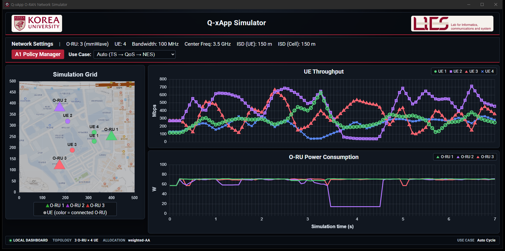
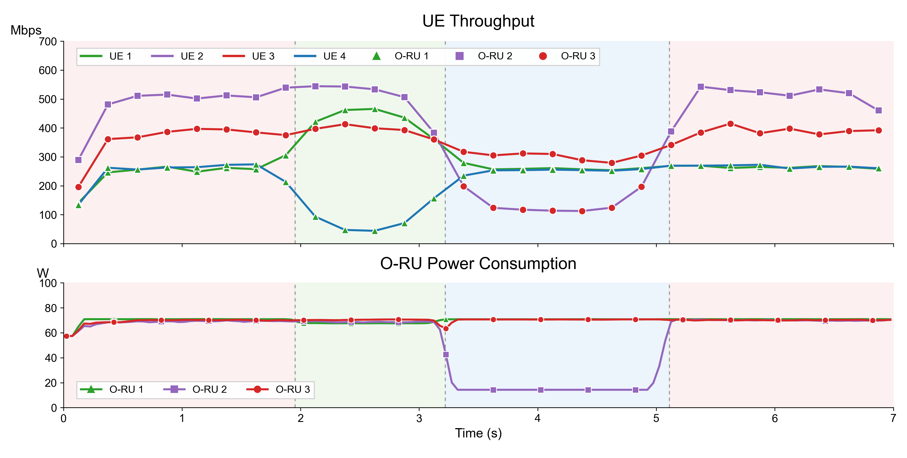
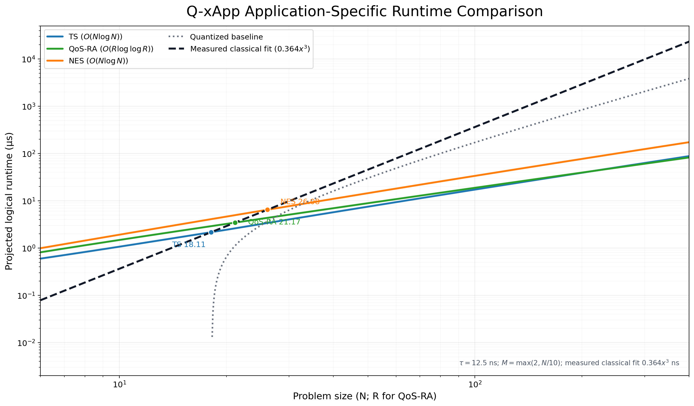
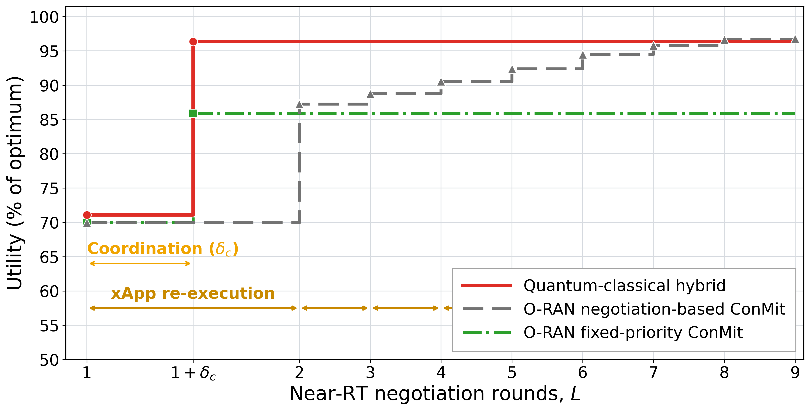

# Q-xApp

Q-xApp is a quantum-enabled near-real-time O-RAN controller built around
FlexRIC, ns-O-RAN, and Qiskit. This repository is the compact public release:
the current simulator GUI, the unified controller and simulator overlay, the
final Fig. 4 100-run artifact, the final Fig. 5 release, and the two current
assignment-circuit configurations.

## Current release

| Component | Public artifact |
| --- | --- |
| Simulator | Current dark Windows/Web GUI in [`gui/`](gui/) |
| Controller | Unified TS, NES, and QoS-RA xApp in [`flexric/xApp/qxapp_unified.c`](flexric/xApp/qxapp_unified.c) |
| Fig. 4 | Weighted-AA 100-run result and compact evidence in [`fig4_ppt/`](fig4_ppt/) |
| Fig. 5 | Frozen 2026-08-12 limited-projection release in [`fig5/`](fig5/) |
| Quantum assignment | Current controller-default weighted-AA path in [`dqna_ts.py`](flexric/xApp/dqna_ts.py) |
| Assignment with Knapsack | Current weighted-PRB path in [`dqna_modes.py`](flexric/xApp/dqna_modes.py) and [`dqna_constraints.py`](flexric/xApp/dqna_constraints.py) |

## Simulator GUI



The active GUI source has a single runtime path:

- FastAPI entry point: [`gui/main.py`](gui/main.py)
- Dashboard: [`gui/src/templates/chart.html`](gui/src/templates/chart.html)
- API and data control: [`gui/src/http/data_controller.py`](gui/src/http/data_controller.py)
- ns-3/InfluxDB pusher: [`gui/src/copy_sim_data_pusher.py`](gui/src/copy_sim_data_pusher.py)
- Native Windows shell: [`gui/desktop/qxapp_simulator.py`](gui/desktop/qxapp_simulator.py)
- Interactive scenario: [`ns3/scenario/scenario-zero-with_parallel_loging.cc`](ns3/scenario/scenario-zero-with_parallel_loging.cc)

The dashboard is bound to loopback by default because its research-control
endpoints are unauthenticated. Do not expose port 8000 directly to an
untrusted network.

### Launch on Windows

Requirements: WSL2 with an Ubuntu distribution, Docker inside WSL, Microsoft
Edge WebView2, and Python 3 on Windows.

```powershell
$Venv = Join-Path $env:LOCALAPPDATA "QxAppDesktop\venv"
py -3 -m venv $Venv
& "$Venv\Scripts\python.exe" -m pip install -r gui\desktop\requirements.txt

# HostData is the WSL path containing the ns-3 output and xApp config files.
powershell -ExecutionPolicy Bypass -File gui\desktop\launch_qxapp_simulator.ps1 `
  -WslDistro Ubuntu `
  -HostData /path/to/ns-O-RAN-flexric/mmwave-LENA-oran
```

The launcher starts the WSL Docker GUI stack, waits for the dashboard, and
opens the dark native window. Its backend log is stored at
`%LOCALAPPDATA%\QxAppDesktop\backend.log`.

For browser-only use, run
`QXAPP_HOST_DATA=/path/to/mmwave-LENA-oran docker compose up -d` inside
`gui/` and open <http://127.0.0.1:8000>.

## Final paper artifacts

The paper's reference [15] resolves to this repository. The cited implementation
details are split across the pinned [`install/`](install/) overlays for
ns-O-RAN/FlexRIC, the unified controller and current solvers under
[`flexric/xApp/`](flexric/xApp/), the reusable assignment circuits described in
[Current quantum assignment circuits](#current-quantum-assignment-circuits), and
the figure artifacts and runtime derivations below. Frozen paper artifacts and
the current `HEAD` implementation are identified separately wherever they are
not bit-for-bit equivalent.

### Fig. 4: 100-run near-RT control



The final graph aggregates independent `RngRun=1..100` executions of the
seven-second automated cycle:

1. Traffic Steering
2. Traffic Steering + QoS-RA
3. Network Energy Saving
4. wake and post-wake Traffic Steering recovery

The public compact evidence consists of:

- [`runs_summary_100run.csv`](fig4_ppt/runs_summary_100run.csv)
- [`phase_stats_raw_100run.txt`](fig4_ppt/phase_stats_raw_100run.txt)
- [`qxapp_fig4_plot_100run.py`](fig4_ppt/qxapp_fig4_plot_100run.py)
- [`oru_power_model_100run.json`](fig4_ppt/oru_power_model_100run.json)
- [`PROVENANCE_100RUN.md`](fig4_ppt/PROVENANCE_100RUN.md)
- [`SHA256SUMS_100run.txt`](fig4_ppt/SHA256SUMS_100run.txt)

```bash
# Cross-platform: applies the repository's LF policy to text artifacts and
# retains byte-exact checks for binary/Fig. 5 release files.
python scripts/check_release_integrity.py

export QXAPP_NS_ROOT=/path/to/ns-O-RAN-flexric/mmwave-LENA-oran
export QXAPP_FLEXRIC_ROOT=/path/to/flexric
export QXAPP_SOLVER_DIR="$QXAPP_FLEXRIC_ROOT/examples/xApp/c/ctrl"
export QXAPP_XAPP_BIN="$QXAPP_FLEXRIC_ROOT/build/examples/xApp/c/ctrl/xapp_qxapp_unified"
export QXAPP_PY=/path/to/qxapp-venv/bin/python
export QXAPP_NS3_RUN_USER="$(id -un)"

bash scripts/run_weighted_fig4_batch.sh 1 100 <batch-dir>
python fig4_ppt/qxapp_fig4_plot_100run.py <batch-dir> fig4_ppt
```

The stored 100-run artifact has frozen execution hashes. The current solver
source has evolved since that batch, so a run from `HEAD` is a new
protocol-level experiment, not a bit-for-bit reproduction of the frozen raw
batch. See the provenance file before making an exact-reproduction claim.

### Fig. 4 QPU-active-time projection

The paper's `58.4 ms` result is a hardware-aware projection of the complete
candidate-generation workload used by the coordination analysis. It is not the
measured `~24.5 s` wall-clock time of the SDK-based CPU Statevector
implementation, a single circuit-shot duration, or a measurement from a live
IBM job. It is also distinct from the `1.888020 ms` single-`AQ`, `44.910600 ms`
top-1-optimum, `1.045400832 s` adaptive-batch, and the application-specific
analytical crossover figures below. The projected workload uses six spatial copies
of the selected full circuit.

#### Candidate criterion

The candidate semantics are fixed to the paper workload: a raw sample is
accepted only when `aux == 0`, accepted assignments are checked classically for
feasibility, duplicates are removed, and the remaining feasible assignments are
ranked by classical utility. The target is 16 distinct feasible candidates.
The exact finite-shot occupancy calculation requires **114 independent raw
samples** to reach that target with probability at least 95%; `114` is therefore
the top-16 sampling requirement, not an arbitrary shot count.

#### Fez mapping

For this projection, the selected 17-logical-qubit circuit consists of the
initial weighted state-preparation block followed by two amplification blocks
(`AQ²`). Six complete copies are composed on disjoint logical registers, with
no shared ancillas or inter-copy gates. The composite therefore uses
`6 x 17 = 102` logical qubits and returns six independent candidate samples per
shot without changing their distribution.

The composite was mapped to a frozen `ibm_fez` target snapshot rather than
submitted to a live QPU. The target records 156 physical qubits, Heron r2,
backend version `1.2.8`, properties timestamp
`2025-02-26T15:16:25-05:00`, and `dt = 4 ns`; the QPU-specific snapshot came
from the official `qiskit-ibm-runtime 0.48.0` package. Qiskit `1.2.4`,
transpiler optimization level `2`, `seed_transpiler = 2`, and ASAP scheduling
produce a Fez-native six-copy circuit with `175,316` `cz` gates, depth `82,444`,
and scheduled composite duration `3.073008 ms`.

#### 58.4-ms calculation

The six samples returned by each composite shot reduce the sequential shot
count using an integer ceiling:

```text
required independent samples = 114
samples per composite shot   = 6
composite shots              = ceil(114 / 6) = 19

projected QPU-active time
= 19 composite shots x 3.073008 ms/composite shot
= 58.387152 ms
~= 58.4 ms
```

`R = 6` was not chosen by assuming ideal `1/R` scaling. Composite circuits for
`R = 1..9` were actually transpiled on the 156-qubit target with the fixed
level-2 seed. Layout and routing changed the critical path, so the scheduled
duration was non-monotonic; `R = 6` was the minimum observed active wall-clock:

| Copies `R` | Logical qubits | Composite duration | Composite shots | Projected active time |
| ---: | ---: | ---: | ---: | ---: |
| 1 | 17 | 2.809632 ms | 114 | 320.298048 ms |
| 4 | 68 | 2.690568 ms | 29 | 78.026472 ms |
| 5 | 85 | 6.465652 ms | 23 | 148.709996 ms |
| **6** | **102** | **3.073008 ms** | **19** | **58.387152 ms** |
| 8 | 136 | 4.179032 ms | 15 | 62.685480 ms |
| 9 | 153 | 5.764020 ms | 13 | 74.932260 ms |

#### Scope

The scheduled makespan includes mapped native gates, measurement duration, and
scheduler-inserted idle `delay`. It excludes reset between shots, repetition
delay, host/QPU feedback, job queueing, network transport, E2/control-path
latency, and live-device noise, drift, or crosstalk. Accordingly, `58.4 ms` is
a **projected QPU-active time**, not end-to-end latency or a live-device
guarantee. The `~24.5 s` CPU Statevector wall-clock and this scheduled QPU
projection use different execution definitions, so their ratio is not a
measured speedup. Their large numerical difference mainly reflects replacing
numerical CPU Statevector evolution with scheduled native-gate execution, not
an empirical end-to-end acceleration result.

This hardware-aware projection is separate from the analytical scalability
model below, whose first strict integer crossovers occur at 19--27 entities.
Frozen Fez gate durations are not used in that model, and neither result is a
measurement of hardware advantage.

### Analytical scalability model

The revised model follows the application-specific oracle structures. TS uses
O-RU-local population counters, NES uses one population counter for two awake
O-RUs, and QoS-RA uses two DRB-address rows. With
`M = max(2, N/10)`, `k = ceil(log2 M)`, `w = ceil(log2(N + 1))`, and
`q = ceil(log2 R)`, the smooth scheduled depths are

Each UE–resource utility parameter $\theta_{uc}$ is encoded through controlled
rotations on cost ancillas, while feasibility information is stored in
constraint ancillas. The joint reflection marks states for which the constraint
ancillas indicate feasibility and the utility ancillas are in the all-zero
state. Amplitude amplification therefore favors feasible assignments with
higher encoded utility.

For a Boolean feasible-set oracle over candidate space $\mathcal C$ and feasible
set $\mathcal F$, the conventional iteration estimate is

$$
r_{\mathrm{AA}}=\left\lfloor
\frac{\pi}{4}\sqrt{\frac{|\mathcal C|}{|\mathcal F|}}
\right\rfloor.
$$

In the experiments reported here, the iteration count is typically a small
integer; the $3\times4$ assignment uses one or two amplification iterations.

```text
TS:
  D_TS(N) = 2N log2(N) + 2 log2(N) + 2 log2(N/10)
            + N/5 + log2(N log2(N/10)) + 3
  D_TS(N) = O(N log N)

NES:
  D_NES(N) = 4N log2(N) + 4 log2(N) + 7
  D_NES(N) = O(N log N)

QoS-RA:
  D_QoS(R) = 4R(1 + log2(log2 R)) + 3 log2(log2 R) + 4
  D_QoS(R) = O(R log log R)

t_quantum(x) = tau D(x)
t_classical(x) = 0.364 ns * x^3
```

The displayed TS closed form applies for `N >= 20`; the plotted curve retains
`M = max(2, N/10)` below that point. The NES curve uses the balanced `A = 1`
smooth envelope, while the `N = 27` runtime includes the odd-`N` value `A = 2`.
The runtime figure uses the effective analytical layer latency
`tau = 12.5 ns`; `50 ns` is retained as a baseline. The measured classical
assignment fit is `0.364 ns x x^3`. Qubit totals count explicit circuit
registers; compiler-selected synthesis ancillas are excluded unless instantiated
as work qubits.

| Logical latency | TS | QoS-RA | NES |
| ---: | ---: | ---: | ---: |
| 50 ns | N ≈ 39.60 | R ≈ 43.93 | N ≈ 57.29 |
| 12.5 ns | N ≈ 18.11 | R ≈ 21.17 | N ≈ 26.08 |

At `12.5 ns`, the first strict integer advantages are:

| Application | First integer advantage | Q-xApp runtime | Classical runtime |
| --- | ---: | ---: | ---: |
| TS | N = 19 | 2.290 μs | 2.497 μs |
| QoS-RA | R = 22 | 3.603 μs | 3.876 μs |
| NES | N = 27 | 6.857 μs | 7.165 μs |



The complete Clifford+T derivation, qubit accounting, and implementation
correspondence are in
[`Q_xApp_Complexity_tree_gyh_rev2.md`](flexric/xApp/tests/Q_xApp_Complexity_tree_gyh_rev2.md).

### Fig. 5: final limited-projection release



The final release is preserved byte-for-byte under
[`fig5/releases/2026-08-12-limited-projection/`](fig5/releases/2026-08-12-limited-projection/).
It contains the 100-seed three-O-RU-per-domain workload, runner, final outputs,
audits, requirements, and source-bundle checksums.

```bash
python -m pip install -r fig5/releases/2026-08-12-limited-projection/requirements.txt
python fig5/releases/2026-08-12-limited-projection/fig5_final_hungarian_limited_projection_20260812/run_fig5_final.py \
  --output fig5/reproductions/2026-08-12-limited-projection
```

Always use a separate `--output` directory so the frozen release results are
not overwritten. Detailed integrity and interpretation boundaries are in
[`fig5/README.md`](fig5/README.md).

## Current quantum assignment circuits

Only the two current assignment configurations are summarized here.

### Assignment

The controller-default TS solver in [`dqna_ts.py`](flexric/xApp/dqna_ts.py)
maps four UEs to three O-RUs with a maximum-UE-per-cell constraint. Its current
default is adaptive full-state weighted amplitude amplification using the
17-qubit layout:

- 8 assignment qubits
- shared constraint/cost workspace
- phase target and one clean MCX synthesis ancilla
- classical best-of-candidates selection after finite-shot sampling

The representative `k=3` resource row uses 17 logical qubits, transpiled depth
31,798, and 18,102 CX gates under the recorded Qiskit 1.2.4 all-to-all profile.
The complete table is [`reports/v5_resource_table.csv`](reports/v5_resource_table.csv).

### Assignment with Knapsack constraints

The generalized path combines formal weighted-AA in
[`dqna_modes.py`](flexric/xApp/dqna_modes.py) with the reversible weighted-PRB
constraint layer in [`dqna_constraints.py`](flexric/xApp/dqna_constraints.py).
Per-UE/per-cell integer PRB demand is accumulated and compared against each
O-RU budget, making this the current multiple-knapsack-style assignment
configuration.

The representative weighted-PRB `r=3` row uses 18 logical qubits, transpiled
depth 10,738, and 9,355 CX gates under the same recorded profile. See
[`reports/combined_circuit_resources.csv`](reports/combined_circuit_resources.csv).

These are ideal statevector-simulator circuit resources; they are not QPU
latency or evidence of quantum advantage.

## Install the simulator/controller overlay

Validated upstream commits and exact source/destination mappings are recorded
in [`install/`](install/). The installer checks source, upstream preimage, and
post-install SHA-256 values before changing a destination.

```bash
# ns-O-RAN / mmwave-LENA overlay
python3 install/install_overlay.py \
  --manifest install/overlay_manifest.json --dest <ns-O-RAN> --check
python3 install/install_overlay.py \
  --manifest install/overlay_manifest.json --dest <ns-O-RAN>

# Unified FlexRIC xApp and all runtime solver dependencies
python3 install/install_overlay.py \
  --manifest install/xapp_manifest.json --dest <FlexRIC> --check
python3 install/install_overlay.py \
  --manifest install/xapp_manifest.json --dest <FlexRIC>

# Locked solver environment
bash install/setup_solver_venv.sh <venv-dir> <FlexRIC>/examples/xApp/c/ctrl

# GUI
cp -r gui/* <ns-O-RAN>/GUI/

# Build
cd <ns-O-RAN>/mmwave-LENA-oran && ./ns3 build
cd <FlexRIC>/build
cmake -DKPM_VERSION=KPM_V3_00 -DE2AP_VERSION=E2AP_V1 ..
cmake --build . --target xapp_qxapp_unified -j"$(nproc)"
```

The pinned upstream versions are FlexRIC
`oie-ric-taap-xapps@307e1d0a5c26751c9e5595805b668a4f91d09550` and
ns-O-RAN `main@4930827e126ddf5487d7e85326f5000d33db0eb1`, including the nested
submodule commits in [`install/upstream_manifest.json`](install/upstream_manifest.json).

### Run the control loop

```bash
# Terminal 1
<FlexRIC>/build/examples/ric/nearRT-RIC

# Terminal 2: interactive GUI scenario
cd <ns-O-RAN>/mmwave-LENA-oran
./ns3 run "scratch/scenario-zero-with_parallel_loging --N_MmWaveEnbNodes=3 --N_Ues=4"

# Terminal 3
QXAPP_DATA_DIR=<ns-O-RAN>/mmwave-LENA-oran \
QXAPP_PY=<venv-dir>/bin/python \
QXAPP_TS_SCRIPT=<FlexRIC>/examples/xApp/c/ctrl/dqna_ts.py \
QXAPP_42_SCRIPT=<FlexRIC>/examples/xApp/c/ctrl/dqna_42.py \
QXAPP_QOS_SCRIPT=<FlexRIC>/examples/xApp/c/ctrl/dqna_qos.py \
<FlexRIC>/build/examples/xApp/c/ctrl/xapp_qxapp_unified
```

The automated Fig. 4 configuration uses `auto`, cap 2, sleep target 3,
5QI `2,4,7,9`, and quantum enabled:

```bash
printf 'auto\n'    > xapp_mode.txt
printf '2\n'       > xapp_a1_policy.txt
printf '3\n'       > xapp_sleep_config.txt
printf '2,4,7,9\n' > xapp_qos_config.txt
printf '1\n'       > xapp_quantum.txt
```

## Verification

Install the locked solver requirements, then run the compact verification
entry point:

```bash
python -m pip install -r install/solver_requirements.txt
PY=python bash verify.sh quick
PY=python bash verify.sh solver

# GUI checks use their own lightweight environment.
python3 -m venv /tmp/qxapp-gui-verify
/tmp/qxapp-gui-verify/bin/python -m pip install \
  -r gui/requirements.txt pytest==9.1.1
GUI_PY=/tmp/qxapp-gui-verify/bin/python bash verify.sh gui
```

GitHub Actions runs source compilation, manifest/install checks, active solver
checks, GUI asset validation, and GUI tests. Long paper experiments are not
rerun in CI.

## Repository layout

```text
Q-xApp/
├── gui/                 current dark simulator GUI and tests
├── flexric/xApp/        unified controller and current solver runtime
├── ns3/                 exact ns-O-RAN/mmwave-LENA overlay
├── install/             pinned manifests and installer
├── fig4_ppt/            final 100-run Fig. 4 compact artifact
├── fig5/                final frozen Fig. 5 release
├── reports/             the two current circuit-resource tables
├── scripts/             current reproduction and validation entry points
├── docs/                current paper/GUI images and artifact map
└── verify.sh            compact local verification
```

The public branch intentionally excludes local work-in-progress, generated
build products, intermediate figures, one-off patch scripts, and superseded
validation reports.

## Upstream projects and licensing

- [ns-O-RAN](https://github.com/Orange-OpenSource/ns-O-RAN-flexric)
- [FlexRIC](https://gitlab.eurecom.fr/mosaic5g/flexric)

Q-xApp builds on upstream components with their respective licenses. Review
the upstream repositories before redistribution or deployment.
